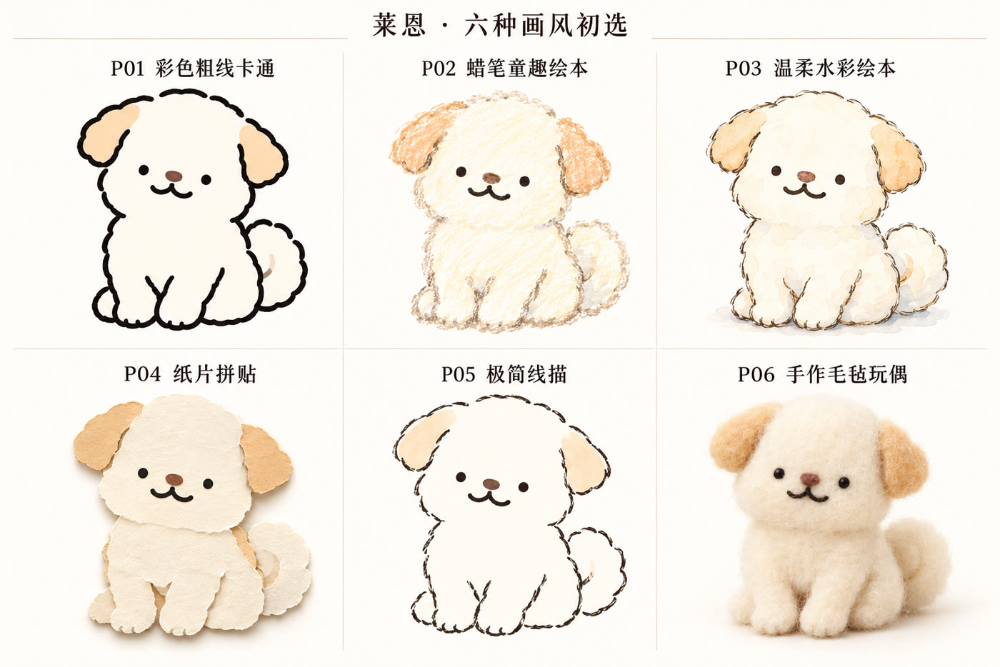

# neil-pet · 宠物专属形象 Skill

用你家宠物的几张照片，定制一个只属于它的卡通形象，再生成它自己的专属 Skill。之后画插画、做配图、做可编辑 PPT，主角都是它，不用每次重新交照片。



*六种初始画风示例（角色为作者的原创形象莱恩）*

## 它会做什么

1. **看照片**：收 5–8 张同一只宠物的清楚照片（正脸、左右侧身、背部／颈后、胸腹，最好拍到爪子和尾巴），整理出必须保留的识别点。
2. **六选一画风**：用同一只宠物出六张小样，你挑一种：

   | 编号 | 画风 |
   | --- | --- |
   | P01 | 粗线彩色卡通 |
   | P02 | 蜡笔绘本 |
   | P03 | 轻水彩 |
   | P04 | 纸片拼贴 |
   | P05 | 极简墨线 |
   | P06 | 针毡玩偶 |

3. **定形象**：先确认一张主形象，再补出需要的视角（正面、侧面、背面等）、六种表情和常用动作。
4. **真实用一次**：拿你自己的内容做一个完整测试，比如一篇文章的配图或一份可编辑 PPT。
5. **打包成专属 Skill**：生成独立的 `宠物名-pet-studio` 文件夹和 ZIP。以后日常创作直接用它，不再需要这个母 Skill。

## 安装

需要**能生图的 AI 环境**（例如 Codex）。没有生图能力的环境只能走到画风说明和提示词这一步。

把整个文件夹放进 Codex 的 skills 目录（通常是 `~/.codex/skills/neil-pet`），重启后在新会话里说：

> 使用 $neil-pet，为我的宠物定制专属形象 Skill。我会提供多角度照片，主要用于文章插画和 PPT。

## 目录

```
neil-pet/
├─ SKILL.md                     流程入口
├─ references/                  照片、画风、角色、应用、打包、来源六份规则
├─ scripts/build_personal_skill.py   专属 Skill 打包器（只打包已确认的素材，不生成图片）
├─ assets/brief-example.json    打包用的角色说明示例
└─ agents/openai.yaml           Codex 界面信息
```

## 验证到哪一步

作者用一只灰白猫完整跑通了针毡玩偶方向：主形象、多视角、六表情、场景插画、文章六张配图和九页可编辑 PPT。其余五种画风做过初选小样，换其他宠物的全流程还需要更多实际使用来检验。动画暂不在能力范围内。

照片和生成的角色图都留在你自己的电脑里，本仓库不包含任何私人照片或测试角色图。

## 来源与许可

方法来源与适配边界见 [references/sources.md](references/sources.md)。

MIT License © 2026 尼尔.S
